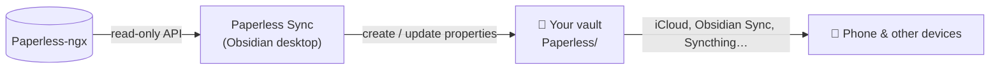

<div align="center">

# 📄 Paperless Sync

**Your paperwork, inside your second brain.**

An [Obsidian](https://obsidian.md) plugin that turns every document in your [Paperless-ngx](https://docs.paperless-ngx.com) archive into a note: metadata as properties, a link back to the original, and room for your own thoughts.

[](https://obsidian.md)
[](https://docs.paperless-ngx.com)
[](#-setup)
[](LICENSE)

</div>

---

Paperless-ngx is great at storing, scanning and searching documents. Obsidian is great at connecting ideas. **Paperless Sync connects the two**: the lease agreement sits next to your moving checklist, the doctor's report links to your health notes, and every invoice from 2024 is one query away.

The PDFs stay in Paperless-ngx. Your vault only gets small, tidy notes like this one:

```yaml
---
paperless_id: 2
paperless_title: "Electricity bill March 2024"
paperless_url: https://paperless.example.com/documents/2/details
paperless_correspondent: City Power
paperless_document_type: Invoice
paperless_tags:
  - Inbox
  - Home
paperless_created: 2024-03-15
paperless_added: 2024-03-16
paperless_field_amount: EUR84.50
---
[Open in Paperless](https://paperless.example.com/documents/2/details)

Write anything you like below. The plugin never touches it.
```

## ✨ What you get

|  |  |
| --- | --- |
| 🗂️ **One note per document** | Title, correspondent, type, tags, dates, ASN, storage path and custom fields as real Obsidian properties. |
| 🔗 **Links, not copies** | Each note links to the original in Paperless-ngx. Turn on *link metadata* and correspondents and document types become `[[links]]` with their own backlinks. |
| 🔍 **Query your paperwork** | Filter and sort with Bases, Dataview or plain search, like any other note. |
| ✍️ **Your notes stay yours** | Only the `paperless_*` properties are managed. Text you write and properties you add are never overwritten. |
| 🔐 **Text only when you say so** | Document text stays in Paperless-ngx. Tag the few documents you want in your vault, and only those get their text. |
| 🚚 **Move and rename freely** | Notes are matched by `paperless_id`, not by path. Reorganize your vault however you want. |
| 🛡️ **Read-only and safe** | Only `GET` requests. Nothing in Paperless-ngx is ever changed, and no note is ever deleted. |
| 🤫 **Quiet by design** | A sync that finds nothing new writes nothing, so iCloud, Obsidian Sync and git stay calm. |
| ⏱️ **Set and forget** | Syncs at startup and on an interval you choose. |

## 🔍 A taste of what's possible

All invoices, newest first, with the amount from a custom field:

````markdown
```dataview
TABLE paperless_correspondent AS "From", paperless_created AS "Date", paperless_field_amount AS "Amount"
FROM "Paperless"
WHERE paperless_document_type = "Invoice"
SORT paperless_created DESC
```
````

Everything still waiting in your inbox:

````markdown
```dataview
LIST FROM "Paperless" WHERE contains(paperless_tags, "Inbox")
```
````

The same works without any plugin in a **Base**: filter on `paperless_document_type` or `paperless_tags` and add the columns you want.

## 🧭 How it works



- **New document** → a new note is created from your file name and note templates.
- **Changed document** → only the `paperless_*` properties are updated, plus the document text section if you [opted the document in](#-document-text-for-selected-documents).
- **Deleted document** → the note stays and gets `paperless_missing: true`. If the document comes back, the flag goes away.

## 🚀 Setup

> [!NOTE]
> Paperless Sync runs on **Obsidian 1.13.2 or newer on desktop** (macOS, Windows, Linux). The notes are ordinary Markdown files, so they still reach your phone with the rest of your vault.

1. **Install** the plugin and enable it.
2. **Get a token:** in Paperless-ngx, open **My Profile** and copy the API token.
3. **Connect:** in Obsidian, open **Settings → Paperless Sync** and enter your server address, for example `https://paperless.example.com`.
4. **Store the token:** under **API token**, create a secret that holds it.
5. Click **Test connection**, then **Sync now**. 🎉

> [!TIP]
> Use a dedicated Paperless-ngx user with **View** permission for documents, tags, correspondents, document types, storage paths and custom fields. If one of the lists other than documents isn't readable, the sync still runs and leaves those properties as they are.

> [!IMPORTANT]
> The token lives in Obsidian's secret storage on your device. It is never written to the vault and never synced. Enter it on each device that should sync.

## ⚙️ Settings

<details>
<summary><b>All settings</b></summary>

| Setting | What it does |
| --- | --- |
| Server address | Address of your Paperless-ngx instance. |
| API token | The secret that holds your API token. |
| Folder | Where new notes are created. Default: `Paperless`. |
| File name | Template for new notes. Default: `{{created}} {{title}}`. Use `/` for subfolders. |
| Note text | Template for the text of new notes. |
| Link correspondents and document types | Writes them as `[[links]]`, so each can have its own note with backlinks. |
| Document text tag | Documents with this tag get their text in a collapsed section of their note. Empty by default, which keeps all document text out of the vault. |
| Include custom fields | Adds custom fields as `paperless_field_<name>` properties. |
| Sync automatically on this device | Syncs at startup and at the interval. Stored per device. On by default. |
| Sync interval | Minutes between automatic syncs. `0` syncs at startup only. |
| Address for links | Base address for document links, if it differs from the server address. |

</details>

<details>
<summary><b>Template variables</b></summary>

File name and note text: `{{title}}`, `{{id}}`, `{{created}}`, `{{created_year}}`, `{{created_month}}`, `{{correspondent}}`, `{{document_type}}`, `{{storage_path}}`, `{{asn}}`.

Note text only: `{{url}}` and `{{content}}` (the document's full text).

Example: `{{created_year}}/{{correspondent}}/{{created}} {{title}}` sorts notes into folders by year and sender.

</details>

Run **Paperless Sync: Sync now** from the command palette at any time.

## 📝 Document text for selected documents

Most paperwork doesn't belong in a vault that is synced to the cloud or read by other tools. So document text stays out unless you opt in per document: set **Document text tag**, for example to `obs-sync`, and give that tag to the documents you want in Paperless-ngx. Their notes get a collapsed section at the end:

```markdown
%% paperless-content start %%
> [!quote]- Document text
> Your payment for March 2024 is EUR 84.50.
%% paperless-content end %%
```

- The section is updated on every sync, so edits inside it are replaced. Write your own notes above or below it.
- Remove the tag from a document and the next sync removes the section from its note.
- Only tagged documents have their text downloaded.
- If the API user may not read tags, existing sections are left as they are.
- Clearing the setting stops the plugin from touching note text. Sections that already exist stay, so remove the tag from those documents first if you want them gone.

## 💡 Good to know

**Several devices, one vault?** Turn on **Sync automatically on this device** on one device only, for example the computer that is always on. The others get the notes through your vault sync. If two devices create a note for the same new document at the same moment, you may get a duplicate. The sync result names it, and you can delete one of the two.

**Limitations**

- File names are set when a note is created. If a title changes later, `paperless_title` is updated but the file keeps its name.
- `{{content}}` in the note template is filled in once, when the note is created. Use the document text tag for text that stays up to date.
- Links in the note text, such as the default `[Open in Paperless]({{url}})`, are not rewritten when the server address changes. `paperless_url` always has the current link.
- Document links in custom fields are written as document IDs.

## 🔒 Privacy

The plugin talks to exactly one server: the Paperless-ngx instance you configure. It reads document metadata and, for documents you opt in, their text. It contacts no other service and collects no telemetry.

## 🛠️ Development

```bash
npm install
npm run dev        # build in watch mode
npm run validate   # lint, test and build
npm run mock       # mock Paperless-ngx API on http://127.0.0.1:8765, token "dev-token"
```

Copy `main.js` and `manifest.json` to `<vault>/.obsidian/plugins/paperless-sync/` to try a build. The mock server serves `dev/mock-data.json` and rereads it on every request, so you can edit documents while Obsidian is running.

Bug reports and pull requests are welcome.

## 📜 License

[MIT](LICENSE). Not affiliated with Obsidian or Paperless-ngx, just a fan of both.
